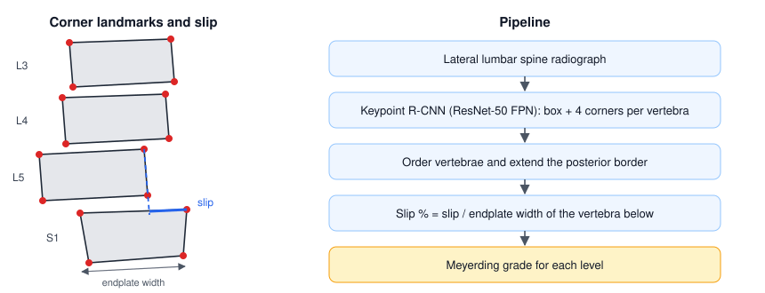

# Spondylolisthesis detection and grading on lumbar spine radiographs

The lumbar vertebrae are detected on lateral X-rays with Keypoint R-CNN, which returns a box and the four corners of each vertebral body. The corners are then used to measure how far each vertebra has slipped over the one below it and to grade the slip on the Meyerding scale.

## Dataset

**Spondylolisthesis Vertebral Landmark** (Mendeley Data, version 1, 2025), CC BY 4.0: https://doi.org/10.17632/5jdfdgp762.1

- 716 lateral lumbar spine radiographs: 208 from Honduran patients diagnosed with spondylolisthesis and 508 lateral views from the public BUU-LSPINE dataset.
- Each vertebra from L3 to S1 was annotated by hand with a bounding box and four corner keypoints, in JSON that Keypoint R-CNN reads directly.
- Split: 494 images for training, 206 for validation and 16 kept for expert clinical evaluation.

If you use the data, please cite the dataset and BUU-LSPINE:

- Reyes K. Spondylolisthesis Vertebral Landmark. Mendeley Data, V1 (2025). https://doi.org/10.17632/5jdfdgp762.1
- Klinwichit P, Yookwan W, Limchareon S, Chinnasarn K, Jang J-S, Onuean A. BUU-LSPINE: A Thai open lumbar spine dataset for spondylolisthesis detection. *Applied Sciences* 13(15):8646 (2023). https://doi.org/10.3390/app13158646

## Notebooks

| Step | Notebook | What it does |
|---|---|---|
| 1 | `1_preprocess_labels.ipynb` | Converts YOLO-style landmark labels into Keypoint R-CNN JSON (boxes, keypoints, labels). |
| 2 | `2_train_keypoint_rcnn.ipynb` | Trains Keypoint R-CNN and evaluates it on the validation split after every epoch. |
| 3 | `3_detect_vertebrae.ipynb` | Runs the trained model on a folder of radiographs and saves boxes and corners as JSON. |
| 4 | `4_inference_single_image.ipynb` | Predicts and plots the vertebrae and corners on one image. |
| 5 | `5_spondylolisthesis_grading.ipynb` | Measures the slip at each level and assigns the Meyerding grade. |

The notebooks were written for Google Colab and their code comments are in Spanish. Each one starts with an English summary; set the paths in its first code cell. Image outputs were removed to keep the repository light.

## Method

- **Model.** `torchvision` Keypoint R-CNN with a ResNet-50 FPN backbone pretrained on ImageNet, two classes (background and vertebra) and four keypoints per vertebra. Anchor sizes run from 32 to 512 pixels with aspect ratios from 0.25 to 4 to fit vertebral bodies.
- **Training.** SGD (learning rate 0.001, momentum 0.9, weight decay 0.0005) with step decay, batch size 3: 10 epochs, then 50 more from the saved weights. The training helpers come from the torchvision detection references, through [scoliovis-training](https://github.com/Blankeos/scoliovis-training), with the keypoint OKS sigmas adapted to four vertebral corners.
- **Post-processing.** Detections with confidence above 0.7 are kept and duplicates are removed with non-maximum suppression (IoU 0.3).
- **Grading.** For each pair of adjacent vertebrae, the posterior border of the upper one is extended until it meets the endplate of the one below. The slip is the distance from that point to the posterior corner of the lower vertebra, as a percentage of its endplate width: up to 10% normal, grade I up to 25%, II up to 50%, III up to 75%, IV up to 100% and V above 100%.

## Results

COCO evaluation on the validation split after the 60 training epochs:

| | AP (IoU 0.50:0.95) | AP at IoU 0.50 | AP at IoU 0.75 |
|---|---|---|---|
| Vertebra boxes | 0.758 | 0.982 | 0.908 |
| Corner keypoints | 0.687 | 0.940 | 0.775 |

## Requirements

Python 3 with PyTorch, torchvision, OpenCV, NumPy, Matplotlib, Pillow, pycocotools and albumentations. Google Colab already includes most of them.

## Related publication

Reyes-Leiva KM. Prediction of spinal abnormalities in neuroradiology images applying deep transfer learning. *2023 IEEE International Conference on Machine Learning and Applied Network Technologies (ICMLANT)* (2024). https://doi.org/10.1109/ICMLANT59547.2023.10372991

## Intended use

Research code only. It is not a medical device and has not been validated for clinical diagnosis.

## Contact

Karla Miriam Reyes Leiva, PhD. [Website](https://drkarlareyes.github.io) · ORCID [0000-0002-3269-0830](https://orcid.org/0000-0002-3269-0830)

Code: MIT licence. Dataset: CC BY 4.0.
